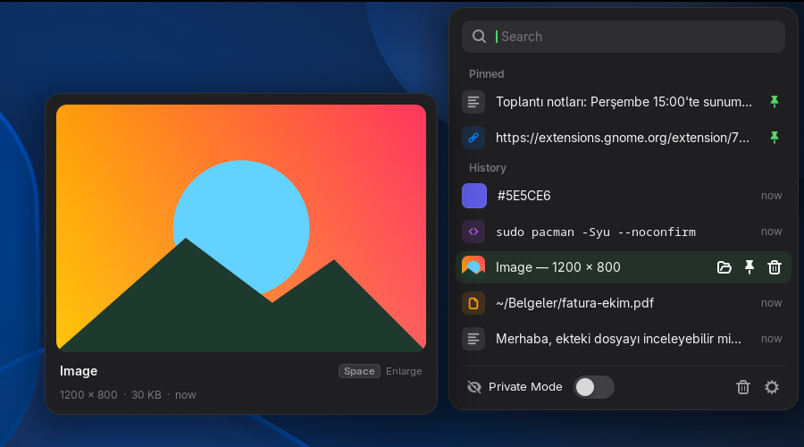
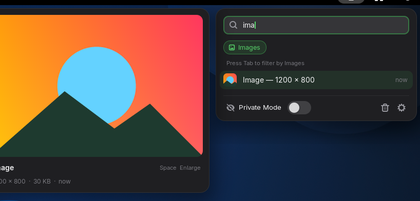
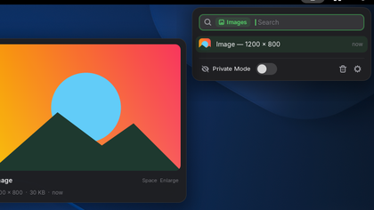
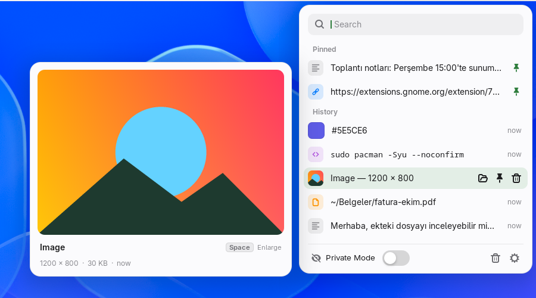
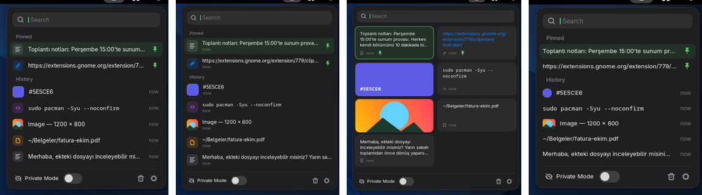

# Clipboard+

**A minimal, beautiful clipboard manager for GNOME Shell.** Made by Dukha.

Clipboard history for text, images, screenshots, links, colors, code and files — with instant search,
smart filters, a large preview card, pinning, private mode and full keyboard navigation.
Open it with <kbd>Alt</kbd>+<kbd>C</kbd>.



## Features

- **Everything you copy** — text, images, links, colors, code and file paths, each with its own badge
- **Large preview card** — hover an entry (or move with ↑ ↓) and a single big preview appears next to the popup:
  full images, the whole text, link details, color values (HEX / RGB / HSL). Press <kbd>Space</kbd> to enlarge it,
  or to open a link in the browser.
- **Show in folder** — screenshots and copied files have a folder button that opens their folder with the file selected
- **Instant search** — just start typing. Filters (Images, Links, Code, Pinned …) appear only while you search;
  type `ima` and press <kbd>Tab</kbd> to turn it into a filter.
- **Pin** important entries, **edit** text, add **tags**
- **Private Mode** and **excluded apps** — password managers are excluded by default, and copies marked
  as secret by apps are never recorded
- **Four layouts** — Default, Spotlight, Cards and Compact
- **Subtle motion and sound** — short, low UI sounds (slightly different every time) when opening the popup and
  choosing an entry, plus simple animations; each can be turned off in the preferences
- **Paste on select** — the chosen entry is pasted where your cursor is (on by default, terminals included)
- **Automatic cleanup** — after restart, or every 30 minutes … week; pinned entries are always kept
- Follows the **system accent color** and **light / dark** style
- English and Turkish

| Search with filters | Light style |
| --- | --- |
|   |  |



## Battery friendly

Clipboard+ never polls. It sleeps until the clipboard actually changes (`Meta.Selection::owner-changed`),
builds its list only when you open it, pre-scales images once so the popup never decodes full-size
pictures, and writes history to disk at most once every two seconds. Sound players exist only while the popup is
in use and are released a few seconds later.

## Keyboard

| Key | Action |
| --- | --- |
| <kbd>Alt</kbd>+<kbd>C</kbd> | Open / close (configurable) |
| <kbd>↑</kbd> <kbd>↓</kbd> | Move selection — the preview card follows |
| <kbd>Enter</kbd> | Copy (and paste, if enabled) |
| type | Search |
| <kbd>Tab</kbd> | Apply the suggested filter |
| <kbd>Space</kbd> | Open link or file (in the browser / file manager), enlarge the preview of anything else. Opening can be moved to <kbd>Ctrl</kbd>+<kbd>Enter</kbd> in the preferences |
| <kbd>Ctrl</kbd>+<kbd>P</kbd> / <kbd>E</kbd> / <kbd>T</kbd> | Pin · Edit · Tag |
| <kbd>Delete</kbd> | Delete entry |
| <kbd>Ctrl</kbd>+<kbd>1</kbd>…<kbd>9</kbd> | Copy entry 1–9 |
| <kbd>Esc</kbd> | Clear search, then close |

Global shortcuts for “copy older / newer entry”, “clear history” and “toggle Private Mode” can be set in the preferences.

## Compatibility

GNOME Shell **46, 47, 48, 49, 50 and 51**, on any distribution (Wayland and X11).

## Install

From [extensions.gnome.org](https://extensions.gnome.org/) (search for *Clipboard+* or *clipboard*), or from source:

```sh
git clone https://github.com/uuRCnn/clipboard-plus.git
cd clipboard-plus
tools/build.sh --install
# Wayland: log out and back in, then
gnome-extensions enable clipboard-plus@dukha
```

Build requirements: `gnome-extensions`, `glib-compile-schemas`, `gettext`, `python3`.

## Development

```sh
npm install            # eslint
npm run lint
tools/run-test.sh      # runs the extension in an isolated headless GNOME Shell
                       # and writes screenshots to build/test/
tools/update-po.sh     # refresh translations
```

`tools/run-test.sh` never touches your running session: it uses a private D-Bus session,
private XDG directories and a headless virtual monitor.

### Translations

Add `po/<lang>.po` based on `po/clipboard-plus.pot` and open a pull request.

## Privacy

Clipboard+ reads the clipboard to keep a history. The history is stored only on your computer
(`~/.cache/clipboard-plus`) and is never sent anywhere.

## License

GPL-2.0-or-later © 2026 Dukha

---

### Türkçe

**Clipboard+**, GNOME için sade ve şık bir pano yöneticisidir. Metin, görsel, bağlantı, renk ve kod geçmişini tutar;
anında arama, akıllı filtreler, büyük önizleme kartı, sabitleme, gizli mod ve tam klavye kontrolü sunar.
Arka planda sürekli kontrol yapmaz; yalnızca pano değiştiğinde uyanır, bu yüzden pil dostudur.
Ekran görüntülerini ve kopyalanan dosyaları klasöründe gösterebilir; <kbd>Boşluk</kbd> önizlemeyi büyütür ya da bağlantıyı açar.
GNOME 46–51 sürümlerinde, tüm dağıtımlarda çalışır. Açmak için <kbd>Alt</kbd>+<kbd>C</kbd>.
